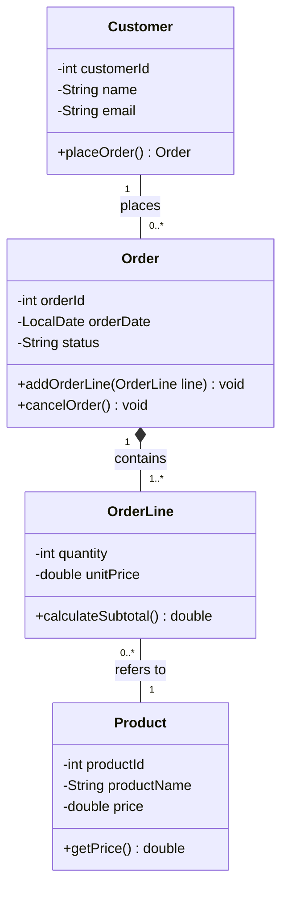

Exercise 4 – Customer Orders
1. Customer – Order
   Relationship: Association

A customer can place multiple orders, but an order belongs to one customer. 
Both customers and orders can exist independently. 
Deleting an order does not mean the customer is deleted.

2. Order – OrderLine
   Relationship: Composition

An order consists of one or more order lines.
Each order line belongs to exactly one order and cannot exist independently. 
If an order is deleted, its order lines are also deleted.

3. OrderLine – Product
   Relationship: Association

An order line refers to a product from the catalog. 
Products exist independently of orders and remain in the catalog even when orders are cancelled or deleted. 
Therefore, association is appropriate.

