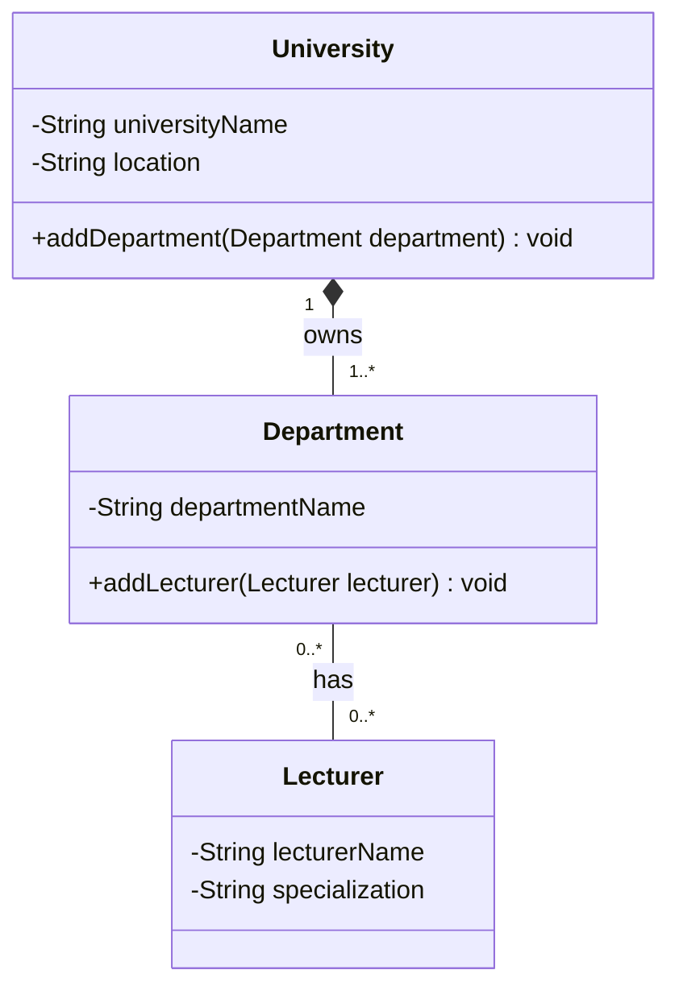

Exercise 2 – University Departments

University – Department (Composition):

A department cannot exist independently of the university. 
It belongs to one university, and if the university is closed, its departments cease to exist. 
Therefore, composition is the correct relationship.

Department – Lecturer (Aggregation):

A lecturer can work in multiple departments and exist independently of them. 
If a department is dissolved, its lecturers can be reassigned to other departments. 
Therefore, aggregation is the correct relationship.

