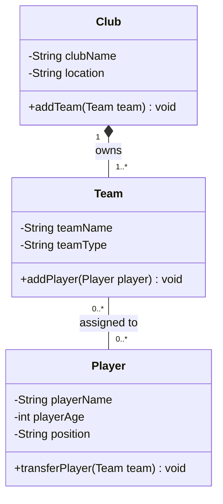

Exercise 3 – Sports Club
1. Club – Team
   Relationship: Composition

A team cannot exist independently of the club. 
Each team belongs to one club, and if the club shuts down, its teams also cease to exist. 
Therefore, composition is the correct relationship.

2. Team – Player
   Relationship: Aggregation

Players can exist independently of a team. 
They can be transferred, loaned to another team, or reassigned if their current team is disbanded. 
Therefore, aggregation is the correct relationship.

